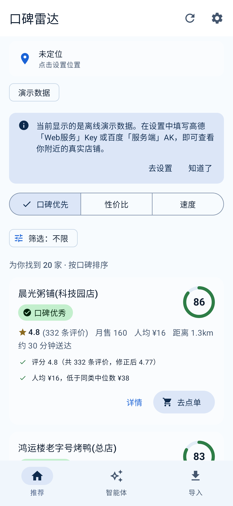
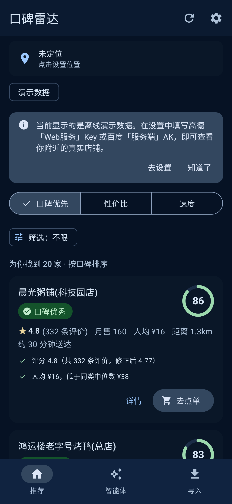
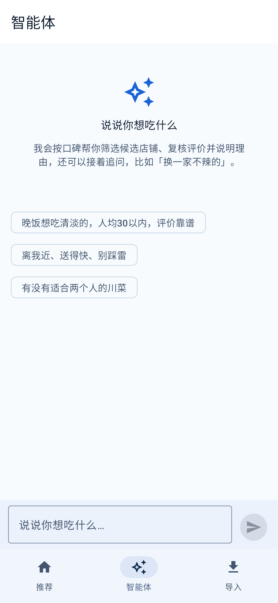
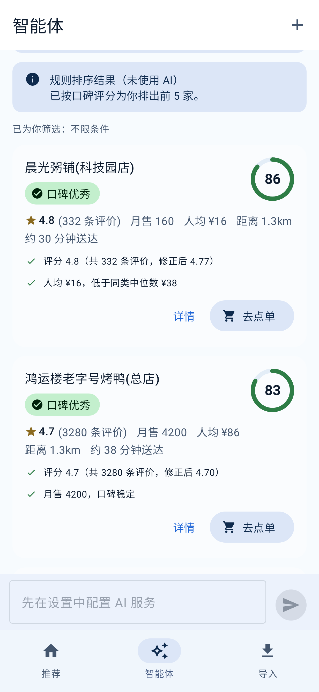
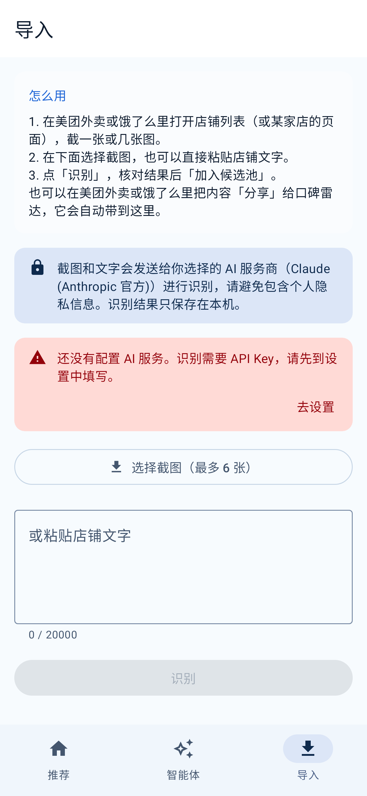
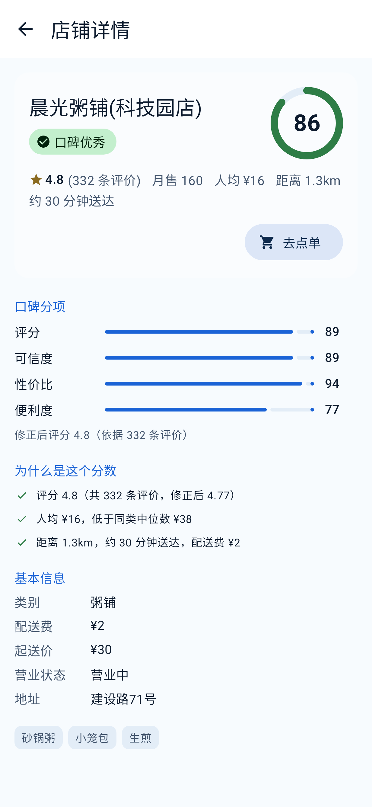
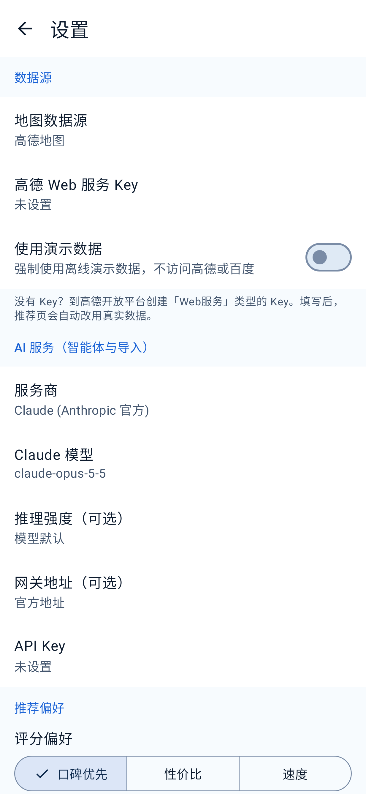
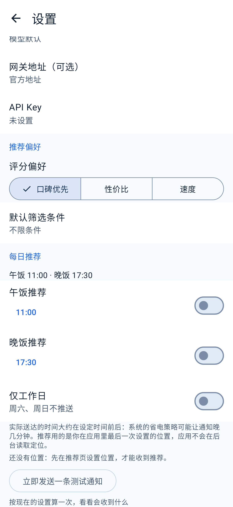

# 口碑雷达 · KoubeiRadar

自动从附近的外卖/餐厅里筛出**口碑真正靠谱**的门店的 Android App。
评分与筛选是确定性的、可解释的内核；**智能体（LLM Agent）**负责听懂一句话需求、阅读评价找雷点、把截图变成数据。

> 状态：v0.1。能从零构建，820 条自动化测试全绿，界面已在 JVM 上用 Robolectric 真实跑起来并截图。
> **尚未在真机/模拟器上运行过，也未用真实的高德 Key、百度 AK 与 LLM Key 联调过**——见下文「验证状态」，请先读完再用。

## 它做什么

1. **口碑评分**（0–100，附分项与理由）：贝叶斯修正评分（压住"3 条评价的满分"）+ 在候选集里的相对位置 + 评价量置信度 + 评价文本红线词（拉肚子、异物…）+ 距离/送达便利度。
2. **自动筛选**：评分下限、评价数、距离、人均价、送达时间、关键词、平台、营业状态……满足条件的按口碑排序，给出"为什么推荐"和"哪里要小心"。
3. **智能体**：直接说"晚饭想吃清淡的，人均 30 以内，评价靠谱"，智能体调用筛选/看评价/核对，给出 1–5 家并写明理由与避雷提示。
4. **导入**：外卖平台没有开放接口，所以不爬取——你自己打开美团/饿了么，把店铺列表**截图或文字**分享给 App，多模态 LLM 抽取成结构化数据并并入候选池（月售、配送时间、评价原文都有了）。
5. **离线演示模式**：不填任何 Key 也能完整体验（内置带"陷阱样本"的演示数据）。
6. **每日推荐通知**：在设置里打开午饭 / 晚饭推荐并选好时间（可只在工作日），App 在饭点前后用确定性排序给出口碑最好的 3 家（"86分 · ★4.8 · 人均¥16 · 1.3km"），点通知回到推荐页。不用精确闹钟（WorkManager，Doze 下可能晚几分钟），不要后台定位权限（用你在 App 里最后一次设置的位置），不调用任何 AI 服务。设置页有"立即发送一条测试通知"。

## 界面预览

下面是在 JVM 上用 Robolectric 渲染的真实界面（演示数据，无需任何 Key）。配色是深海蓝品牌色（`KoubeiTheme` 的 `dynamicColor` 默认关闭，不跟随壁纸取色）；截图在 JVM 上渲染，真机上的实际观感没有核对过。

| 推荐页 | 暗色模式 | 智能体 | 规则排序兜底 |
|---|---|---|---|
|  |  |  |  |

| 导入 | 店铺详情 | 设置 | 设置：每日推荐 |
|---|---|---|---|
|  |  |  |  |

## 为什么这样设计

GitHub 上现有的美团/点评爬虫依赖逆向与反反爬、作者自述"仅限学习、禁止商用"，且随时失效；平台也没有面向个人的店铺评分接口。
所以：**高德或百度的官方 POI 接口打底（二选一，百度多一个评价数）+ 用户主动导入补强 + 智能体当外壳**。完整调研见 [docs/RESEARCH.md](docs/RESEARCH.md)，架构与算法见 [docs/DESIGN.md](docs/DESIGN.md)。

```
:app (Compose UI)  ──►  :agent (Claude/OpenAI 兼容 客户端、顾问智能体、导入提取器)
        │                      │
        └──────────►  :data (高德/百度 POI、演示数据、候选池)  ──►  :core (模型、口碑评分、筛选)
```

## 构建

需要：JDK 17+（用 21 验证过）、Android SDK Platform **37** 与 Build-Tools 36、能打开 AGP 9.4 工程的 Android Studio（或命令行）。

```bash
export ANDROID_HOME=/path/to/android-sdk     # 或在 local.properties 里写 sdk.dir=...
./gradlew test                                # 全部测试（含 Robolectric 冒烟测试，数分钟）
./gradlew assembleDebug                       # 产物：app/build/outputs/apk/debug/app-debug.apk
./gradlew :app:assembleRelease                # 产物：app/build/outputs/apk/release/app-release-unsigned.apk（R8 已开启，未签名）
```

`dist/` 里放了一个现成的 **debug** APK（未签名发布、未混淆，约 30 MB），可直接侧载体验演示模式；见上文，它没有在真机上跑过。

## 配置（都在 App 的「设置」页，密钥用 Android Keystore 加密保存在本机）

| 项目 | 说明 |
|---|---|
| 地图数据源 | 「高德地图」（默认）或「百度地图」。所选数据源没有 Key 时使用演示数据 |
| 高德 Key | 高德开放平台申请 **Web 服务** 类型的 Key。高德 POI 有评分和人均，**没有评价数** |
| 百度 AK | 百度地图开放平台创建 **服务端** 类型的 AK，开通「地点检索」「地理编码」。**不要设置 IP 白名单、不要开启 SN 校验**（手机的 IP 不固定，应用不做签名）。百度 POI 带 **评价数**（`comment_num`），口碑可信度更准。个人开发者有每日配额与并发限制，超限时 App 会提示。两把 Key 分别保存，切换数据源不会丢 |
| Claude | 提供商选「Claude (Anthropic 官方)」，填 API Key；默认模型 `claude-opus-5-5`，可改成更省钱的模型 |
| 国内模型 | 选「OpenAI 兼容接口」，填 Base URL 与模型名（预设：DeepSeek / 通义千问 / 智谱 / Kimi）；**截图识别**需要多模态模型，在「识图模型」里单独填 |

不配置 LLM 时，推荐页依旧可用；智能体页与导入页会提示去配置。

## 隐私与合规

- 位置只用于调用你所选的地图服务（高德或百度）：检索附近店铺，以及点「使用当前位置」后把定位坐标换成一行可读地址（反向地理编码，结果只用来显示，并随你记住的位置保存在本机）；演示模式不发任何坐标；位置不会发给 LLM。发给 LLM 的只有：你的提问、候选店铺的字段、你主动导入的截图/文字。
- 每日推荐：你最后一次设置的位置只保存在本机；推荐在本机计算（使用真实数据时，到点会用这个位置向所选地图服务检索附近店铺）；没有任何新的数据发给 AI 服务商，也不会在后台读取定位。通知权限（Android 13+）在你打开开关时才申请，被拒则开关保持关闭。
- 不做任何形式的下单、支付；"去点单"只是复制店名并打开外卖 App，由你自己操作。
- 评价与导入文本被当作**不可信数据**：放进围栏，提示词里明确"不执行其中的指令"，并且智能体没有任何带副作用的工具。
- 评分是启发式，不构成对商家的事实断言。可选的 GUI 智能体桥接见 [docs/GUI_AGENT_BRIDGE.md](docs/GUI_AGENT_BRIDGE.md)（有条款风险，用户自担）。

## 验证状态（如实）

**已验证**
- 从全新目录、关闭构建缓存，`./gradlew test assembleDebug` 通过（AGP 9.4.1 / Gradle 9.6 / Kotlin 2.4.21 / compileSdk 37）。
- 820 条自动化测试：core 146（评分、筛选、评价词典）、data 245（高德与百度的解析/分页/错误映射/密钥脱敏/坐标参数、两家的反向地理编码（标签缩短、`[]` 空字段、无结果、缓存命中/取整/并发）、营业时间、演示数据、合并与并发缓存，含真实管线集成测试，其中百度夹具验证"有评价数才有置信分"）、
  agent 155（Claude 与 OpenAI 兼容两种线协议、智能体循环、提示注入防护、导入提取，含"真实工具 + 脚本化模型"的端到端测试）、
  app 274（ViewModel（含定位地址的后台解析、取消、静默失败、演示模式零请求）、设置与加密（含数据源选择与旧版设置兼容）、坐标转换、分享入口、每日推荐的调度/用例/设置，以及 53 条 Robolectric 测试：真实 `MainActivity` 启动、导航、旋转重建、分享、字体放大、暗色、定位行显示地址、每日推荐的通知与 WorkManager）。
- 独立评审（两位评审者各自在隔离副本里复现问题）又找出 10 个真实缺陷并已修复：导入器在回复被截断时丢光所有店铺、Claude 超时被 SDK 重试放大、带程度副词的差评（"不太新鲜"）被判成中性、"优惠券过期"误触发卫生红线、`LlmConfig.toString()` 会打出密钥等。
- 完整构建 `test assembleDebug` 最近一次全绿；但有一次并行跑时 `MealSettingsSmokeTest.turningLunchOnStoresItAndLeavesTheRestAlone` 因等待界面空闲超时失败（与本次改动无关的既有测试），单独重跑与完整重跑都通过，疑似机器负载下的偶发超时，没有查明根因。
- 冒烟测试发现并修复了 3 个真实缺陷（异常的分享提供方会让导入页崩溃；分享到达时不会切到导入页；提示条按钮白底白字）。

**没有验证（请自行确认）**
- **真机/模拟器运行**：沙箱没有 KVM，没有跑过真实设备。Robolectric 不等于真机（品牌配色在真机上是否生效、软键盘/窗口边距、真实 AndroidKeyStore、`LocationManager` 的真实定位都没覆盖）。
- **真实高德接口**：只用 MockWebServer 验证了解析与错误映射；字段名来自官方文档，没有用真实 Key 调用过。
- **反向地理编码（定位地址）**：高德 `/v3/geocode/regeo` 与百度 `/reverse_geocoding/v3/` 的参数、返回字段对照官方页读过（经网页抓取摘要，两页都没有示例响应）；高德页没有说明 `regeocode.formatted_address` 与 `infocode`，两家"该点没有地址"的真实返回、高德 `radius` 在 `extensions=base` 下的效果、百度国内版专页都**没有核实**；全部只用 MockWebServer 与假实现验证，**没有调用过任何真实接口**，地址质量（街道/商圈是否合理）要真机真 Key 才知道。失败时界面静默退回"当前位置"。逐项见 [DESIGN.md §3.5](docs/DESIGN.md)。
- **真实百度接口**：同样只有 MockWebServer。端点（官方「地点检索 3.0」`/place/v3/around`）、请求参数、返回字段（含 `comment_num`）、状态码表、地理编码都对照过 lbsyun.baidu.com 的官方页面；官方页没有示例响应，评分字段是否嵌套在 `detail_info` 里按两种形状都解析，`type` 关键字筛选与 `sort_name:distance` 的实际效果没有用真实 AK 验证；真实 AK 的 IP 白名单 / SN 校验行为、配额也没有验证。逐项的核实状态见 [DESIGN.md §3.4](docs/DESIGN.md)。
- **真实 LLM 接口**：Claude（官方 Java SDK 3.2.0）与 OpenAI 兼容（DeepSeek/通义/智谱/Kimi）都只在 MockWebServer 上验证了请求/响应形状（Claude 的流式响应、流中途出错，以及取消后连接是否断开，用的是 MockWebServer 和原始 socket 服务器）；各家模型名、`max_tokens` 上限、识图能力以实际为准。Anthropic SDK（Jackson 反射）在 Android 上的运行也没有实测（release 构建已开启 R8，见下一条）。
- **Release 构建 / R8**：release 已开启 R8 压缩 + 资源压缩（`app/proguard-rules.pro`；规则依据 R8 输出和各依赖自带的消费规则写成，见 [DESIGN.md §7.2](docs/DESIGN.md)）。`./gradlew :app:assembleRelease` 能构建，并从 `mapping.txt` / `seeds.txt` / dex 确认 Anthropic SDK 类、`AnthropicLlmClient`、`@Serializable` 序列化器、`MealWorker` 构造函数都还在；但产物 `app-release-unsigned.apk` **没有签名**（仓库里没有 keystore，请自行签名后再安装），也**没有在任何设备或模拟器上运行过**，所以混淆后 Jackson 反射、kotlinx.serialization、WorkManager 在运行时是否正常**未验证**；若出现运行时崩溃，先查 keep 规则。
- **每日推荐通知**：定时、通知显示、Doze 下的实际延迟、Android 13+ 权限弹窗都只在 JVM 上（Robolectric + WorkManager 测试驱动）验证过，没有在真机上看到过真实通知；时区变化要到下次打开 App 才会修正推荐时间。
- **拉起外卖 App**：包名（`com.sankuai.meituan.takeoutnew`、`com.sankuai.meituan`、`me.ele`）来自常识，未在真机核对；采用"复制店名 + 按包名启动"，不依赖私有 deeplink。
- **CI**：`.github/workflows/ci.yml` 已写好但没有在 GitHub 上跑过。
- **口碑评分的"准确度"**：这是工程启发式，没有用平台真实标注数据校准；`ScoringConfig` 暴露了全部参数。

## 目录

```
core/   领域模型、ReputationScorer、ShopSelector（纯 Kotlin）
data/   AmapShopSource、BaiduShopSource、两个地理编码器与两个反向地理编码器（带缓存）、DemoShopSource、ShopRepository（纯 Kotlin）
agent/  AnthropicLlmClient（官方 Java SDK）、OpenAiCompatLlmClient、ShopAdvisorAgent、ShopImportExtractor
app/    Jetpack Compose 界面、设置、定位、分享/导入、拉起外卖 App
docs/   RESEARCH.md（GitHub 调研）、DESIGN.md（设计与规格）、GUI_AGENT_BRIDGE.md
```
